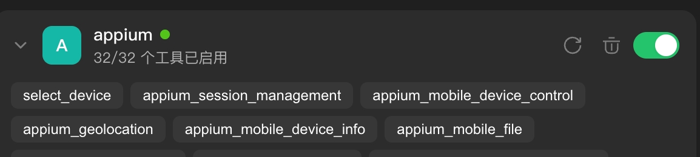
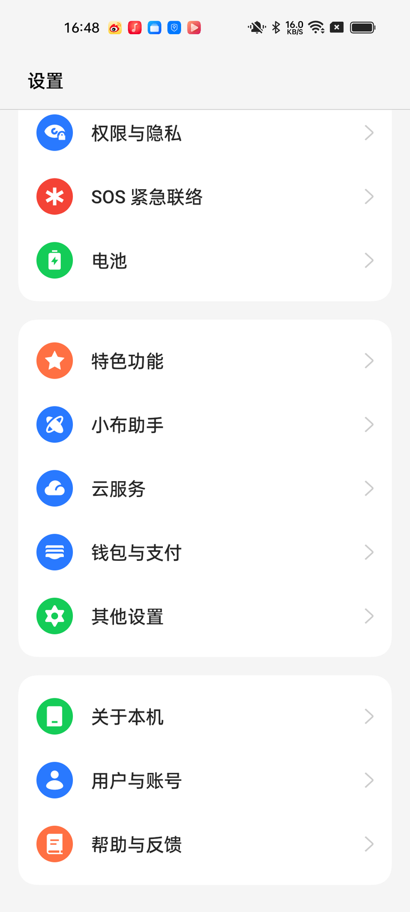
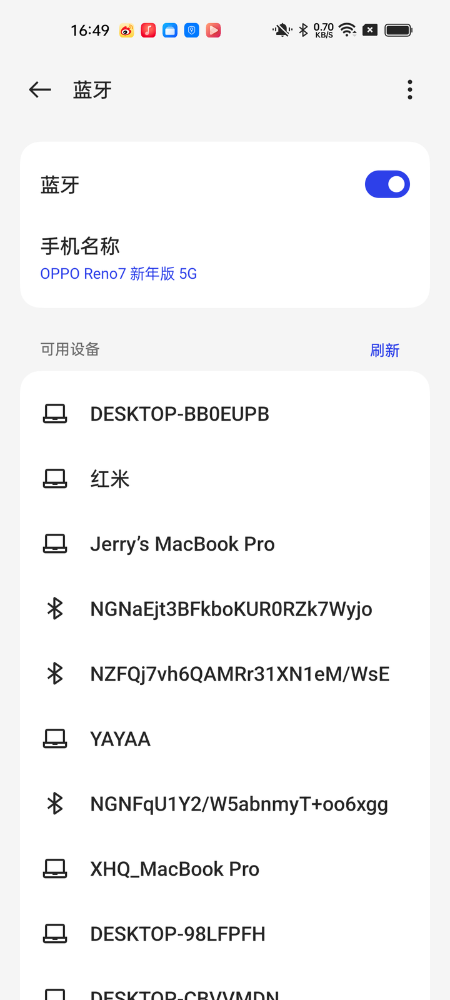
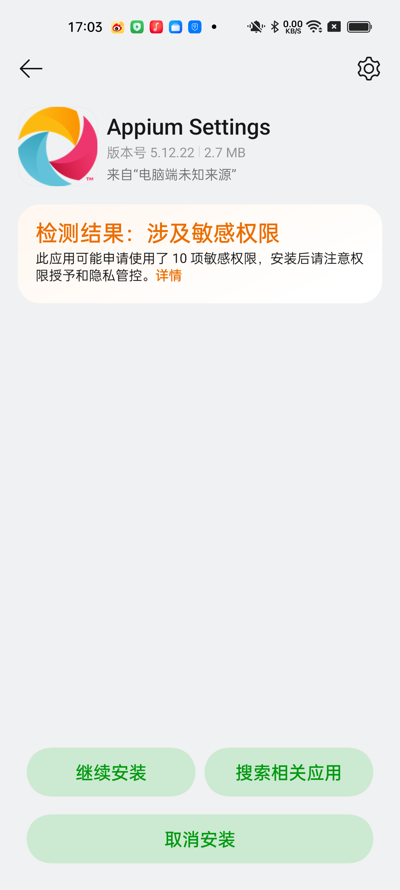

# 不写 XPath，让 AI 在真机上跑测试：Appium MCP 全流程实战

> 版本基准：源码核对与实测基于 **appium-mcp v1.99.1**（2026-11-05）；截至本文发布，上游最新版为 **v1.99.3**（2026-11-04 仍有提交）
> 上游热度：GitHub **517 stars / 96 forks**（2026-11-05 查询）

**结论先行**：把 Appium 官方的 MCP server（appium-mcp）接进 AI 助手，你可以用一句自然语言——「打开设置，把蓝牙关掉」——驱动 AI 在安卓真机上完成探索、定位、点击、断言的全过程，最后还能让它把操作固化成可回归的测试代码。整个过程零 API key、零视觉模型、零额外服务：一台开了 USB 调试的安卓手机 + 一根数据线就能跟做。

本文的差异化在两处：一是全流程给实测数据（每步耗时、工具调用链），二是给出「分阶段方法论」——官方 40 多个工具直接丢给 AI 之外，还有更好的用法。

---

## 1 为什么是 Appium MCP

传统移动端自动化有三高：

- **门槛高**：Java/Python + Appium 全家桶 + WebDriver API，环境配一天起步。
- **维护高**：XPath 一改就碎，UI 一改一排用例红。
- **复现难**：脚本写好了，别人跑不起来，问题出在环境而不是用例。

MCP（Model Context Protocol）改变的是交互方式：AI 助手直接持有「控制手机」的工具集——截图、找元素、点、滑、输入、读文本——你用自然语言下指令，它看着屏幕层级实时决策。写 XPath 的活儿消失了，因为 AI 自己读 page source。

appium-mcp 是 Appium 官方团队维护的 MCP server（已进 appium.io 官方生态页），本文全程使用它。本教程覆盖 Android 真机 + 系统设置 App——设置 App 零 APK 分发问题，任何读者拿自己手机就能跟做。iOS 真机涉及 WDA 签名，留到续篇。

## 2 15 分钟环境准备

四样东西：

| 依赖          | 要求       | 验证命令              |
| ----------- | -------- | ----------------- |
| Node.js     | ≥ v22    | `node --version`  |
| JDK         | ≥ 8      | `java -version`   |
| Android SDK | adb 可用   | `adb devices`     |
| 真机          | USB 调试已开 | 同上，看到 `device` 状态 |

appium-mcp 有两种驱动模式：**内嵌模式**（默认，无需安装全局 Appium server，包内自带 uiautomator2 驱动）和 **远程模式**（配 `remoteServerUrl` 对接已有 Appium 服务）。本文用内嵌模式，读者零额外部署。

把 server 写进 WorkBuddy 的 MCP 配置（`~/.workbuddy/mcp.json`）：

```json
{
  "mcpServers": {
    "appium-mcp": {
      "disabled": false,
      "type": "stdio",
      "command": "npx",
      "args": ["appium-mcp@latest"],
      "env": {
        "ANDROID_HOME": "/Users/你的用户名/Library/Android/sdk"
      }
    }
  }
}
```

两个坑提前说：

- **ANDROID_HOME 必须显式写**。就算你终端里 `echo $ANDROID_HOME` 有值，MCP server 是独立进程，不一定继承你的 shell 环境。路径写错的表现是工具调用报错，而不是启动失败——排查时先查这里。
- **Node 版本卡 v22**。appium-mcp 的 engines 要求 v22+，v20 会直接装不上或运行时炸。

配好之后，`adb devices` 应该能看到你的设备在线：

```
$ adb devices
List of devices attached
ABCD1234EFGH	device      # 正常状态是 device；unauthorized 表示手机上还没点「允许 USB 调试」
```

然后在连接器管理页对新 server 点 **Trust**——**这一步不能漏，也不会有任何报错**：不点 Trust，工具列表里就是空的，新手 90% 卡在这里。首次 `npx appium-mcp@latest` 会冷启动下载依赖（包本体 1.9 MB / 593 个文件，但依赖不小），实测**约 2 分 20 秒**；期间没有任何进度提示，别以为卡死了。




## 3 第一条指令：打开设置，关掉蓝牙

指令原文：

> 打开设置，找到蓝牙开关，把它关掉，然后确认它已经关了。

为什么选这个场景：蓝牙开关在设置 App 里有稳定的 resource-id（安卓原厂 ROM），AI 需要走完「打开 App → 找到入口 → 定位开关 → 执行 → 断言」完整链路，但每一步都不难——是验证链路的最小完整任务。

值得知道的是：appium-mcp 的 `appium_mobile_device_control` 工具只有 lock / unlock / shake / open_notifications 四个动作，**没有直接开关蓝牙的捷径**——AI 必须真的在 UI 里走一遍，跟人手操作同一条路。这正是「UI 自动化」的本意：测的就是用户视角的路径。

**这次首跑的工具调用链**（2026-11-05 实测，OPPO Reno7 / ColorOS，共 13 次工具调用）：

| # | 工具名 | 关键参数 | 目的 |
|---|---|---|---|
| 1 | `select_device` | platform=android | 发现真机（1 台 USB 设备在线） |
| 2 | `appium_session_management` | action=create | 建立 UiAutomator2 会话（约 18 秒，含驱动推送） |
| 3 | `appium_screenshot` | — | 记录初始画面 |
| 4 | `appium_app_lifecycle` | action=activate, id=com.android.settings | 打开设置 |
| 5 | `appium_screenshot` | — | 设置首页（注意：停在页面底部） |
| 6 | `appium_gesture` | action=scroll_to_element, xpath `//*[@text="蓝牙"]`, direction=up | 上滑 2 次找到入口 |
| 7 | `appium_find_element` | strategy=xpath, selector=`//*[@text="蓝牙"]` | 拿到 elementId |
| 8 | `appium_gesture` | action=tap, elementUUID=…3d | 进入蓝牙页 |
| 9 | `appium_get_page_source` | pattern=蓝牙, saveToFile=true | 读层级定位开关，发现 `checked="true"` |
| 10 | `appium_screenshot` | — | 关键帧：开关开着 |
| 11 | `appium_gesture` | action=tap, x=930, y=442 | 点击开关关闭 |
| 12 | `appium_get_page_source` | pattern=switch_widget | 断言 `checked="false"` |
| 13 | `appium_screenshot` | — | 关键帧：开关已关 |

**三个真实坑（本文最有价值的部分）**：

1. **开关节点是 `clickable="false"`**。真机上这个节点的完整属性是 `class="android.widget.Switch" resource-id="android:id/switch_widget" checkable="true" checked="true" clickable="false"`——父节点 `android:id/widget_frame` 也是 `clickable="false"`。**「定位到元素」和「元素可点击」是两件事**，这一点是确定的。
   但要说清楚：我第一次跑时「对 elementUUID 直接 tap 不生效、只能按 bounds 取中心坐标点」——**第二次复现时同样的 elementUUID tap 直接成功了**（`关闭 → 开启`，页面结构随之变化）。所以我不能断言"clickable=false 就点不动"，只能记录这个不一致：**很可能当时是页面还没稳定就点了**。对你的意义是——遇到点了没反应，先确认页面稳定状态，再怀疑元素本身。
2. **设置首页不是从顶部开始的**。这台机器上次停在页面底部，AI 打开设置时看到的是「权限与隐私 / 电池 / 关于本机」——如果直接假设顶部有蓝牙入口就会找不到。所以第 6 步用了 `scroll_to_element` 而不是"先截图再看"。
3. **蓝牙页属于另一个包**。ColorOS 的蓝牙设置页 package 是 `com.oplus.wirelesssettings`，不是 `com.android.settings`——跨 ROM 差异的真实体现。

**耗时**：从下第一条指令到断言完成，**共 110 秒**，其中建立会话约 18 秒，其余为 UI 操作与 AI 决策。

**关键帧**：






**先说结论：这次跑得很顺，而且"顺"本身就是本教程最重要的一次观察。** 为什么？因为这个任务的**路径是明确的**——设置里有蓝牙入口，开关有稳定 resource-id，模型全程不需要做决策，照着指令走就是了。110 秒完成，中间没有一次重试和回退。

顺，说明链路通。但"AI 帮我操作手机"的价值上限，取决于它在**路径不明确**的任务上表现如何——那是第 5 节的主题，也是我为什么让你先跑这个"太简单"的场景：你得先亲眼见过它顺的样子，才能在下一节识别出它开始乱的样子。

## 4 从会话到资产：生成可回归的测试代码

上面跑完的只是一次「会话」——关了终端就没了。测试自动化的产出物得是**代码资产**：可回归、可入 CI、可给团队复用。

appium-mcp 自带 `appium_generate_tests` 工具。但读它的源码（v1.99.1，`src/tools/test-generation/generate-tests.ts`）会发现一个有意思的真相：**它不是代码生成器，是「SOP 注入器」**。工具本身只返回一段工作流指令文本，大意是：

1. 没会话先建会话；
2. 用 `appium_find_element` 拿目标元素 ID；
3. 只有点击的元素才可点，只有可聚焦的元素才能输入；
4. 交互失败就换更稳的定位策略重试；
5. **所有步骤在真会话上执行完之后才准生成代码——"never generate from the scenario alone"**（绝不允许只看脚本描述就凭空写用例）。

真正写代码的是宿主 AI 模型，工具返回的这段指令就是给它的工作纪律。换句话说：**官方自己就在用 prompt 约束模型分阶段行事**——这不是社区玄学，是上游设计。

用起来很简单：

> 把刚才关蓝牙的操作生成一份 TestNG 测试代码。

AI 会按上述工作流先复述操作序列，再产出 Java/TestNG 代码（含 Page Object 结构）。

### 生成的代码

下面这份是模型按上面那段工作流、基于真机上真实观察到的定位信息写出来的（**不是凭空编的**：`android:id/switch_widget` 和 `//*[@text='蓝牙']` 都是在会话里实际找到过的）：

```java
package tests;

import io.appium.java_client.android.AndroidDriver;
import io.appium.java_client.android.options.UiAutomator2Options;
import org.openqa.selenium.By;
import org.openqa.selenium.WebElement;
import org.openqa.selenium.support.ui.ExpectedConditions;
import org.openqa.selenium.support.ui.WebDriverWait;
import org.testng.Assert;
import org.testng.annotations.AfterClass;
import org.testng.annotations.BeforeClass;
import org.testng.annotations.Test;

import java.net.URL;
import java.time.Duration;

public class BluetoothToggleTest {

    private AndroidDriver driver;
    private WebDriverWait wait;

    @BeforeClass
    public void setUp() throws Exception {
        UiAutomator2Options options = new UiAutomator2Options()
                .setUdid("ABCD1234EFGH")   // 换成 `adb devices` 里你的设备序列号
                .setAppPackage("com.android.settings")
                .setAppActivity(".Settings")
                .setNoReset(true);
        driver = new AndroidDriver(new URL("http://127.0.0.1:4723"), options);
        wait = new WebDriverWait(driver, Duration.ofSeconds(20));
    }

    @Test
    public void turnOffBluetooth() {
        // 1. 进蓝牙设置页
        WebElement bluetoothEntry = wait.until(
                ExpectedConditions.presenceOfElementLocated(By.xpath("//*[@text='蓝牙']")));
        bluetoothEntry.click();

        // 2. 关掉主开关
        WebElement switchWidget = wait.until(
                ExpectedConditions.presenceOfElementLocated(By.id("android:id/switch_widget")));
        switchWidget.click();

        // 3. 断言已关闭
        wait.until(d -> "关闭".equals(
                d.findElement(By.id("android:id/switch_widget")).getAttribute("text")));
        Assert.assertEquals(
                driver.findElement(By.id("android:id/switch_widget")).getAttribute("text"),
                "关闭",
                "蓝牙主开关应处于关闭状态");
    }

    @AfterClass
    public void tearDown() {
        if (driver != null) {
            driver.quit();
        }
    }
}
```

**实测结果**：`mvn test` → `Tests run: 1, Failures: 0`，8.5 秒跑完；系统层复查 `dumpsys bluetooth_manager` → `enabled: false, state: OFF`（跑之前是开着的），即它真的把蓝牙关了，不是自我安慰的断言。

### 那要手改吗？——代码零改动，改的全是环境

这是我这次最意外的发现：**生成的 Java 代码一行都没改就跑通了**。所有坑都在环境侧，而且每一个都不是「AI 写得不对」：

**手改 1（必须）：pom 里锁死 Selenium 版本**

第一次 `mvn test` 连编译都过不去：

```
[ERROR] 无法访问org.openqa.selenium.ContextAware —— 找不到类文件
[ERROR] 无法访问org.openqa.selenium.html5.LocationContext —— 找不到类文件
```

查下去是版本解析的锅：`java-client 9.4.0` 对 Selenium 声明的是**开区间** `[4.26.0, 5.0)`，Maven 老老实实解析到当时最新的 `4.52.0`；而 Selenium 在 **4.34.0** 里删掉了 `ContextAware` 接口，`AndroidDriver` 仍在实现它 → 编译期找不到类。

实测边界（逐个版本拆 jar 验的）：`4.33.0` 有 `ContextAware`，`4.34.0` 没有。所以：

```xml
<!-- 手改 1：锁 Selenium 4.33.0，绕开 4.34.0 移除 ContextAware 导致的编译失败 -->
<dependencyManagement>
  <dependencies>
    <dependency>
      <groupId>org.seleniumhq.selenium</groupId>
      <artifactId>selenium-bom</artifactId>
      <version>4.33.0</version>
      <type>pom</type>
      <scope>import</scope>
    </dependency>
  </dependencies>
</dependencyManagement>
```

**手改 2（必须）：独立 Appium server 要能看见 ANDROID_HOME**

```
Message: Neither ANDROID_HOME nor ANDROID_SDK_ROOT environment variable was exported.
```

注意这个坑的隐蔽之处：我在配 MCP 时已经把 `ANDROID_HOME` 写进 MCP 的 env 里了，MCP 用得好好的；但**跑生成的代码需要另起一个独立 Appium server**，那是另一个进程，环境变量得单独给：

```bash
ANDROID_HOME=/path/to/your/android-sdk \
ANDROID_SDK_ROOT=/path/to/your/android-sdk \
appium --port 4723 --address 127.0.0.1
```

**手改 3（必须，且最坑）：两套 driver 抢着装同一个 APK**

这一条我单独放在 §4.1 说，因为它会让你怀疑人生。

**可选改进（不是必须）**：断言用 `text == "关闭"` 是中文硬编码，换英文系统就挂。更稳的是断言 `getAttribute("checked").equals("false")`——开关节点本来就有 `checkable="true" / checked="true|false"`。

### 4.1 为什么你的代码跑不起来，而别人的教程里很顺：两套驱动在抢装同一个 APK

Appium 的 UiAutomator2 驱动在建会话时要往手机装两个辅助 APK：`io.appium.settings`（管 toast/权限/剪贴板等）和 `appium-uiautomator2-server`（执行引擎）。问题出在**这两份 APK 是跟着 driver 版本走的**：

| | 全局 Appium server | appium-mcp（npx 缓存内） |
|---|---|---|
| driver 版本 | appium-uiautomator2-driver **4.0.1** | 内嵌 **8.7.2** |
| 自带 settings APK | io.appium.settings **5.12.22**（2.83 MB） | **8.4.3**（3.12 MB） |

于是：你跟着 §2 用 MCP 跑通了（8.4.3 装上了），到了 §4 起独立 server 跑代码——它发现设备上的版本和自己要的不一致，**先卸载、再装自己那份**；装完你再回去用 MCP，MCP 又发现不一致，**再卸再装**。两个 driver 来回覆盖，每次覆盖都要过一遍系统安装确认。

更糟的是：在国产 ROM 上，这次「重装」大概率**装不上**（见下），失败时它已经把旧版本卸了——我实测到这里时设备上 `io.appium.settings` 直接变成 0 条，两边都用不了了。

**解法：把两边版本对齐。** 让全局 server 也用 8.7.2：

```bash
appium driver update uiautomator2     # 把 4.0.1 升到与 MCP 内嵌一致的 8.7.2
```

对齐之后，两边自带同一份 APK，谁也不会再触发重装——这是我这套环境里唯一稳定的组合。

### 4.2 国产 ROM 的四道门槛（最后一道才是病根）

**① 安装被安全中心拦下**：ColorOS 会在 adb 安装时弹 `com.oplus.appdetail/.guide.InstallGuideActivity`——「检测结果：涉及敏感权限 → 继续安装」。自动化卡在这里，60 秒后 adb 超时，表现为 `install ... timed out after 60000ms`。logcat 里还有一句吓人的 `PackageInstaller: PC install attack detected!` + `OPLUS_ADB_INSTALL_CANCEL`。



**② 点了确认还是失败**：如果你点「继续安装」时，发起安装的 adb 进程已经被杀掉（比如命令超时被回收），那个弹窗就是**僵死的**——点了只会走到「安装失败」页。必须让 `adb install` 保持存活（放受管后台任务里跑）的同时点确认，才装得上。

**③ 装完之后还有一屏广告**：安装成功后 ColorOS 停在「安装成功 + 推荐应用」全屏页。这一页会把后面所有 UI 操作挡住——症状是 `//*[@text='蓝牙']` 找不到，看着像定位失败，实际是屏幕上盖着一个安装器页面。我在这里白跑了两轮测试。**装完记得按返回键把它关掉。**

**④ 真正的元凶：`-g` 参数（这条最反直觉）**

上面三条都是症状，翻 logcat 才挖到病根：

```
appdetail_install_task: installApp io.appium.settings error
You need the android.permission.INSTALL_GRANT_RUNTIME_PERMISSIONS permission
to use the PackageManager.INSTALL_GRANT_RUNTIME_PERMISSIONS flag
```

`adb install -g` 的意思是「装完顺手把所有运行时权限都授予」。ColorOS 的安装器（`com.oplus.appdetail`）**没有 `INSTALL_GRANT_RUNTIME_PERMISSIONS` 这个权限**，于是带 `-g` 的安装直接被拒；而 **Appium 内部装辅助 APK 时正是带 `-g` 的**——所以它在国产 ROM 上必然失败，表现就是卡满 60 秒超时。

去掉 `-g` 一次就过：

```bash
APK=~/.npm/_npx/*/node_modules/appium-mcp/node_modules/appium-uiautomator2-driver/node_modules/io.appium.settings/apks/settings_apk-debug.apk
adb -s <你的设备> install -r "$APK"          # 注意：不要加 -g
adb -s <你的设备> shell dumpsys package io.appium.settings | grep versionName   # 确认 8.4.3
```

预装好之后，MCP 建会话时检测到版本一致，直接跳过安装环节——这才是「会话秒建」的原因。


## 5 分阶段方法论：不裸调工具

### 5.1 先接住上一节那个「为什么这么顺」

第 3 节关蓝牙一气呵成，不是因为 AI 特别聪明，是因为那个任务的**路径是明确的**：设置里有「蓝牙」入口，开关有稳定 resource-id，模型全程不需要做决策——它只需要执行。指令里每一个名词，在界面上都唯一对应到一样东西。

真正的问题是：**当指令里的名词在界面上不对应任何唯一答案时，它会怎么办？**

于是我换了个任务，同一个模型、同一台机器、同一个 MCP，跑两遍。

### 5.2 实验设计

任务：**「找出设置里所有与位置信息相关的开关，记录每个当前开/关状态」**

选它的理由是它有三重负担：一是**入口分散**（系统级开关在「位置信息」页，应用级权限在「权限管理」里，两处不相邻）；二是**要遍历**（应用级涉及 129 个 App）；三是**要聚合**（得记住看过什么、漏了什么）。而且成功与否可以客观核对——这正是企业里会付钱的那类任务（合规审计）。

两次运行唯一的不同：跑之前给不给流程约束。

- **A 组（裸调）**：只给上面那句话，40+ 个工具随便用，跑完就算。
- **B 组（SOP）**：按「探索 → 设计 → 执行 → 固化」四阶段走，每阶段有明确的进出条件。

### 5.3 数据

| 指标 | A 组 裸调 | B 组 SOP |
|---|---|---|
| 工具调用次数 | **37** | **32** |
| 墙钟耗时 | **3 分 52 秒** | **3 分 04 秒** |
| 找到的开关 | 3 个（定位服务 开 / WLAN 扫描 开 / 蓝牙扫描 关） | 3 个（同上，逐项核对一致） |
| 应用级权限（129 个 App） | **未覆盖，且报告里没有任何提示** | **未覆盖，但明确写出原因与前置条件** |
| 走错的岔路 | 2 处（「定位控制」子页无开关、白跑；「应用管理」129 个 App 逐个进不现实） | 2 次无效点击（元素在屏外 `y=2375`、点了没反应），随即修正 |
| 结果可复现 | 不能（没说怎么找到的，换台机器无法照做） | 能（入口路径 + 边界条件全部写明） |

### 5.4 数据说明了什么——以及没说明什么

**先说没说明的：我原以为「裸调会显著烧轮次」，实测不支持。** 37 次对 32 次，只差 14%；耗时差 21%。这点差距不足以支撑「裸调很烂」的结论。上一版大纲里我写的「AI 会乱点瞎猜」——**在你用强模型的前提下，是错的**，这里如实更正。

**真正的差异在最后一行：它不会告诉你它漏了什么。**

A 组的输出是一张干净的表格——三个开关，状态齐全，看起来完整。但它漏掉了 129 个 App 的位置权限，而且**报告里一个字都没提**。你把它交上去，没人看得出来这是个残次品。

B 组走到「权限管理」时撞上一个弹窗：「开启权限监控，可以保护手机的隐私和数据」——这是**设备状态的变更**，不该由 AI 自作主张。SOP 在这里停下，把这一项写进「未覆盖清单」并注明前置条件；裸调则是绕过去、继续走，最后当它不存在。

这就是我为什么把主立论换成下面这条。

### 5.5 三条立论

**① 主立论：SOP 是模型参差的对冲（C 位）**

我这次实验用的是强模型，它裸调也能跑出及格结果。但你的读者不会都用同一个模型——同一段提示词，换个中等模型，37 次调用可能变成 60 次，也可能在第 12 步就忘了自己要找什么。

SOP 的作用是把**流程纪律从模型能力里解耦出来**：不管模型强弱，它都必须先探索、再设计、后执行、最后声明覆盖。强模型因此更稳，弱模型因此不至于崩。这才是方法论真正的价值，而且它不会被我这次「裸调也不差」的实测推翻——反而被它解释得更清楚。

**② 次立论：路径不明确的任务，无约束试错是真实成本**

A 组两处岔路（定位控制死胡同、129 个 App 的不可枚举）不是"乱点"，是**没人事先告诉你哪条路是死的**。SOP 的「探索阶段」做的就是先画地图再走路——B 组少走的那 5 次调用，全在这两处。

**③ 第三条：生成代码之前必须验证真实页面**

这条不是我发明的，是 appium-mcp 自己在 `appium_generate_tests` 里写死的纪律：**"Execute all steps in order before emitting an Appium test... never generate from the scenario alone"**。第 4 节的代码之所以一行没改就能跑，正是因为它基于真机上实际找到的 `android:id/switch_widget`，而不是模型「记得」安卓设置页长什么样。

### 5.6 SOP 四阶段（可直接抄给 AI）

```
阶段 1 · 探索（只读，不点任何会改变状态的东西）
  - 逐层 dump 页面结构，建立入口地图：哪个页面有哪几个可点条目
  - 输出：一张「入口 → 页面 → 元素」的清单
  - 进不去的地方记下来，不要硬试

阶段 2 · 设计（写清单，先不执行）
  - 把任务拆成「系统级」和「应用级」两类，各自列出待查项
  - 每项写清：怎么找到它、取什么属性判断状态
  - 明确标注：哪些项需要改变设备设置才能查（这类要先问人）
  - 输出：一张待执行清单，含预期调用次数

阶段 3 · 执行（严格按清单，一次一项）
  - 点击前确认元素在可视区内（bounds 落在屏幕里），不在就先滚
  - 元素 ID 导航后可能失效，换页必须重新 find
  - 每次操作后 dump 一次状态，不要凭「应该点了」下结论

阶段 4 · 固化（产出必须带覆盖声明）
  - 输出表格：项名 / 所在路径 / 当前状态
  - 强制写「未覆盖清单 + 原因」，没有就写"无"
  - 附上入口路径，让别人能照着重跑一遍
```

**A 组和 B 组的真正差距，全在阶段 4 那一句「强制写未覆盖清单」上。** 前面三个阶段，强模型裸调也能糊过去；只有这一条，它不会主动做。


## 6 进阶一瞥

三样东西本文刻意不碰，但你应该知道它们存在：

- **视觉定位**：appium-mcp 有个 `appium_ai` 工具，能用自然语言描述找元素（「底部那个黄色按钮」）。但它默认**不注册**——需要配 `AI_VISION_ENABLED=true` 加外部视觉模型 API（OpenAI 兼容接口，官方示例是阿里云 DashScope 的 Qwen3-VL-235B）。也就是说它是服务端自费调外部 API，不是靠宿主模型的多模态，不配 key 就没有这个工具。适合元素没有稳定 id、必须靠视觉特征定位的场景。
- **OCR / YOLO 自建定位服务**：生产级方案，门槛在模型服务部署，本文不展开。
- **iOS 真机**：需要 Xcode 签 WebDriverAgent，appium-mcp 提供了 `appium_prepare_ios_real_device` 一步步引导，续篇见。

## 7 这不只是玩具

回看完整链路：**一句自然语言 → AI 在真机上探索定位执行断言 → 固化为可回归的测试代码**。中间没有任何「写脚本」环节。

对个人：手机上任何重复操作（设置审计、App 数据清理、回归验证）都可以一句话委托。对团队：这就是「业务人员描述意图、AI 产出工程资产」的最小闭环——测试用例的生产线从「会写代码的 QA」变成「会描述意图的任何人 + 一个靠谱的执行端」。

留个互动：你最想让 AI 替你在手机上干什么重复操作？评论区或 issue 告诉我，下一篇拿呼声最高的场景做实战。

## FAQ

**Q: 需要 API key 吗？**  
A: 不需要。本文全流程零 API key。唯一的付费可选项是 §6 的视觉定位（外部视觉模型 API）。

**Q: 模拟器行不行？**  
A: 行，把 capabilities 里的 udid 指向模拟器即可。但本文教程用真机写，因为「真机」才是测试的信任基础。

**Q: AI 找不到元素会乱点吗？**  
A: 路径明确的任务（如本文 §3）不会，实测很稳。路径不明确的任务它也不会"乱点"，而是无约束试错——换定位策略反复重试，烧的是轮次和时间，这是 §5 方法论解决的问题。

**Q: 生成的代码质量如何？**
A: 比我预期好——**一行没改就跑通了**（`mvn test` 8.5 秒通过，系统层复查蓝牙确实关了）。缺点有两个：断言用的是中文文案 `text == "关闭"`，换英文系统就挂，应改成断言 `checked` 属性；定位用的是 `//*[@text='蓝牙']`，属于文本定位，主题/语言一变就失效。真正会让你卡住的不是代码，是 §4.1 那两套 driver 和 §4.2 的国产 ROM 安装闸门。

---

*本文是我的「AI × 移动端测试」系列第一篇。全流程实测于 2026-10-27 至 2026-11-05，工具版本与源码行为以文中标注为准。*
